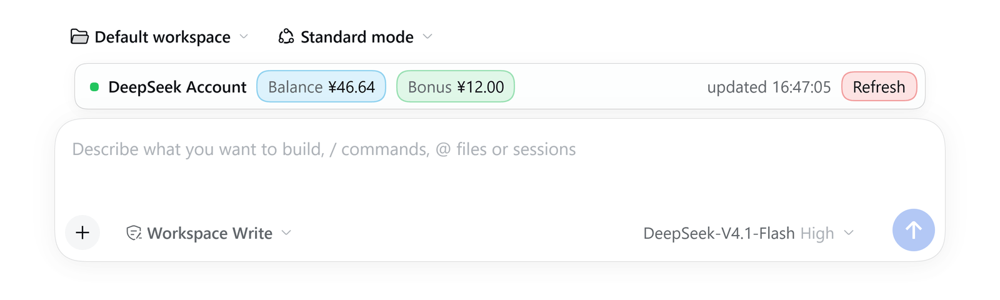
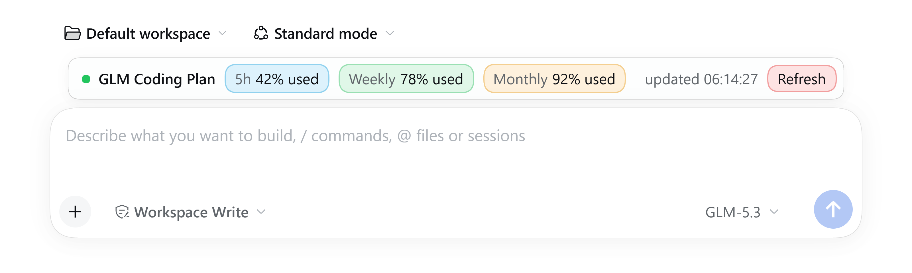
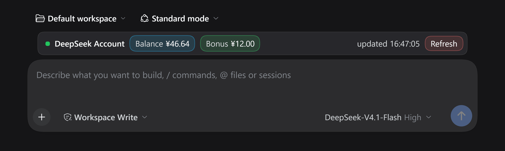
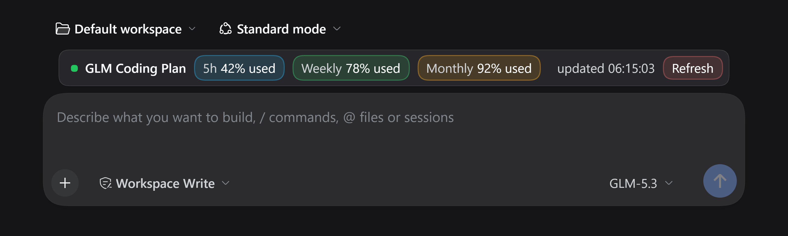

# dsh-quotaline

<div align="center">
  <b>A slim quota strip above the DSH composer: it shows the balance or usage limits of the model you are currently using.</b><br /><br />
  <a href="https://www.npmjs.com/package/dsh-quotaline"></a>
  <a href="https://opensource.org/licenses/MIT"></a>
  <a href="https://www.npmjs.com/package/@deepseek-ai/dsh"></a>
</div>

<div align="center">
  English · <a href="./docs/README.zh-CN.md">简体中文</a>
</div>

---

`dsh-quotaline` embeds a single-line strip in the slot right above the composer. It follows the session's current model: switch to a DeepSeek Account model and you see the account wallet; switch to a DeepSeek API model and you see that API key's balance; Kimi Code and GLM Coding Plan show their 5h / weekly / monthly usage windows instead.

- **In-flow, not a floating widget** — a full-width strip aligned with the composer, above the input box, always visible.
- **Follows the model** — provider/model changes re-query immediately, so brands never mix.
- **Read-only local credentials** — no key prompts, no sync, no upload, and `.credentials.yaml` is never rewritten.
- **Built-in providers + declarative overrides** — DeepSeek, Moonshot/Kimi, Kimi Code, Zhipu, and GLM Coding Plan work out of the box; anything else can be described with an HTTP template in Settings.

## Screenshots

| Account balance · light | Subscription limits · light |
|---|---|
|  |  |

| Account balance · dark | Subscription limits · dark |
|---|---|
|  |  |

Balance and 5h windows use sky blue, bonus and weekly windows use green, monthly windows use amber, and the Refresh pill is a soft red capsule. Bonus stays visible even at zero; a limit window that the provider did not return is simply omitted. Both light and dark themes are supported.

## Features

| Capability | Details |
|---|---|
| **Current model** | Reads the session's `modelSelection` projection and falls back to the profile default for blank sessions. |
| **DeepSeek Account** | Uses DSH's OAuth account service; shows the top-up balance and bonus balance. |
| **DeepSeek API** | `GET {baseURL}/user/balance` with `Authorization: Bearer`, supports CNY and USD. |
| **Kimi Code** | `GET https://api.kimi.com/coding/v1/usages`; understands both legacy `limits[]` payloads and the newer `usages.limit_5h / limit_7d / limit_month_*` shape. |
| **GLM Coding Plan** | `GET {origin}/api/monitor/usage/quota/limit`; maps `unit=3` to hours, `unit=6` to weeks, and `TIME_LIMIT` to monthly. |
| **Moonshot / Zhipu API** | Standard balance endpoints, with automatic fallback when a coding-plan key is rejected by a balance endpoint. |
| **Custom queries** | Method, URL (`{baseURL}`/`{origin}` placeholders), auth style, credential references, and JSON extraction paths (with `[*]` expansion). |
| **Settings page** | `Settings → Quota Line`: refresh interval, live refresh, interface language, read-only built-in template list, custom template editor, and a **Test** button. |
| **Live refresh** | On by default: refreshes after each completed model response while the agent works, delivered over a same-origin event stream; falls back to polling when the stream is unavailable. Ticks are filtered by provider, so subagents on another provider never touch this strip. |
| **Privacy** | Keys stay in the Host process; the browser only receives labels, amounts, currencies, percentages, and error messages. No telemetry. |

### Supported providers

| Provider | Data shown | Endpoint |
|---|---|---|
| DeepSeek Account (`deepseek-account`) | Top-up + bonus balance | DSH account service (OAuth) |
| DeepSeek API (`deepseek-official`) | Balance | `GET {baseURL}/user/balance` |
| Moonshot / Kimi API | Balance | `GET {baseURL}/v1/users/me/balance` |
| Kimi Code | 5h / weekly / monthly usage | `GET {baseURL}/v1/usages` |
| Zhipu API | Balance | `GET {baseURL}/api/paas/v4/balance` |
| GLM Coding Plan | 5h / weekly / monthly usage | `GET {origin}/api/monitor/usage/quota/limit` |

## Numbers and rounding

The strip formats whatever the provider returned and never rewrites stored
values, but the rounding is fixed and documented so two sessions never disagree
about the same number.

- **Balances** use two decimals and round half up: `5.198` shows as `¥5.20`,
  `5.192` as `¥5.19`, and `0.005` as `¥0.01`. Rounding runs on the decimal
  string rather than on a binary float, so a value ending in 5 cannot collapse
  downward (`1.005` stays `¥1.01`).
- **Limits** use whole percentages and round half up: `42.42%` shows as `42%`
  and `42.5%` as `43%`. The "left" mode renders `100 − used` from the rounded
  value, so the used and left readings always add up to exactly 100%.
- **100% and 0% mean the real boundary.** A limit at `99.6%` reads as `99%`
  used, and a remaining share of `0.4%` reads as `99%` left, so the strip never
  claims a quota is exhausted while a fraction is still available.
- Percentages are clamped to `0–100`; a provider that reports more than 100% is
  shown as `100%`.

## Installation

```sh
dsh plugin --profile desktop add dsh-quotaline
```

Replace `desktop` with the profile you actually use (`web`, `desktop`, or a custom name). After installing, restart DeepSeek Harness once so the Host half and the client bundle are both loaded; later client-only updates just need a page refresh.

Requires DeepSeek Harness **0.2.2-rc.3 or newer**.

## Settings

Open **Settings → Quota Line**:

1. **Refresh interval** — idle refresh interval, 10 to 3600 seconds. Switching models always refreshes immediately.
2. **Live refresh during runs** — on by default. The strip refreshes after each model response while the agent works; events are throttled to one refresh every 8 seconds. If the event stream is unavailable it falls back to polling (60s while the stream is connected but quiet, 15s when it is down). Turn it off to refresh only on the idle interval (plus manual, model-switch, and visibility triggers).
3. **Interface language** — follow DSH, or pin the strip and settings page to Chinese or English.
4. **Limit display** — show limit chips as `used` (default) or `left`; the suffix follows the interface language (`used`/`left` or `已用`/`剩余`). Balance chips are unaffected.
5. **Built-in templates** — read-only list showing each id, display name, and whether it is experimental.
6. **Custom templates** — match a provider id (wildcards allowed), choose the display name, method, URL, auth style, credential references, amount path, currency path, and enable it. **Test** performs one real request from the Host and shows the extracted values alongside a response sample.

Example paths:

- DeepSeek API: `balance_infos[*].total_balance`, currency `balance_infos[*].currency`
- Moonshot: `data.available_balance`
- Zhipu: `data.balance` (experimental)

A custom template is stored locally in `$DSH_HOME/dsh-quotaline/settings.json` (`~/.dsh/dsh-quotaline/settings.json` on Windows, `~/.dsh/...` elsewhere). The platform is resolved at runtime, so no path is hard-coded.

## Privacy

- Reads credentials exclusively through the Host `credentials` service; never calls the write methods and never parses or rewrites `~/.dsh/.credentials.yaml` itself.
- Vendor requests originate from the local Host process. The client talks only to the same-origin `/dsh-quotaline/api/*` routes, and responses never contain keys.
- No telemetry, no remote service, no account beyond the providers you already configured.

## Troubleshooting

| Symptom | Fix |
|---|---|
| `No credential` | Save the provider key in **Settings → Models**, or configure the matching environment reference. |
| `No template` | Add a custom template for that provider id; the strip shows the id it could not match. |
| `Query failed` | Use **Test** in the settings page to inspect the HTTP status and a response sample, then adjust the URL or extraction path. |
| `Signed out` | Sign in to your DeepSeek account in **Settings → Account**. |
| The strip is missing | Make sure the plugin is enabled for this profile, then reload the window. |

## Documentation

- [Plugin detail](./docs/DETAIL.md) — the overview shown on DSH's plugin detail page.
- [Architecture](./docs/ARCHITECTURE.md) — Host/Client boundary, route contracts, matching rules, and the template schema.
- [Changelog](./docs/CHANGELOG.md) — release history.
- [简体中文](./docs/README.zh-CN.md) — Chinese README.

## License

MIT © 2026 QianChang927
