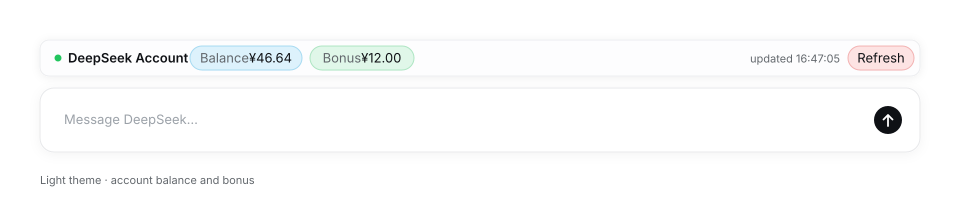
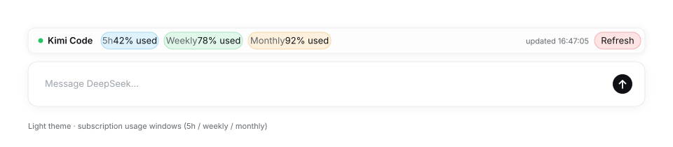
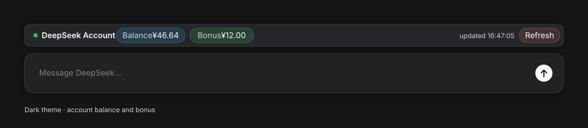
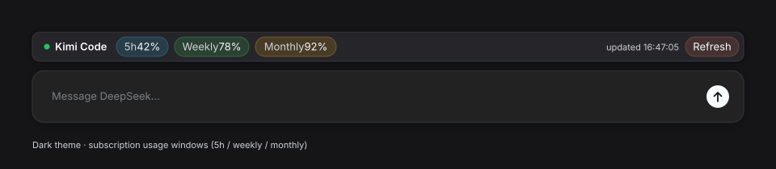

# Quota Line / 额度条

A full-width strip above the composer that shows the current model's balance or quota, read **locally** from your DeepSeek Harness credentials.









## What it shows

- **DeepSeek Account** — Wallet and bonus balances through the signed-in account (OAuth token managed by DSH; no key handling).
- **DeepSeek API** — `GET {baseURL}/user/balance` with the `DEEPSEEK_API_KEY` reference of your `deepseek-official` route.
- **Moonshot / Kimi** — `GET {baseURL}/v1/users/me/balance`.
- **Kimi Code plan** — `GET {baseURL}/v1/usages` (base defaults to `https://api.kimi.com/coding`). Shows the rolling 5-hour window, weekly and monthly limits as used percentages; both the legacy (`limits[]` + `usage`) and plan-ratio (`usages.limit_5h` …) response shapes are parsed.
- **Zhipu GLM** — `GET {baseURL}/api/paas/v4/balance` (experimental; the provider's response schema is not officially documented).
- **GLM Coding Plan** — `GET {origin}/api/monitor/usage/quota/limit`. `unit=3` rows are the 5-hour window, `unit=6` the weekly window, and `TIME_LIMIT` the monthly counter. When a coding-plan endpoint rejects a standard API key, the Host falls back to the balance endpoint automatically.
- **Custom providers** — declarative HTTP templates you add in *Settings → Quota Line*: method, URL with `{baseURL}`, auth type, credential refs, and JSON extraction paths.

The strip follows the model selector of the current session and refreshes immediately when the provider/model changes. Every `refreshSeconds` it polls again while the page is visible.

Chips follow the active light/dark theme: balances and the 5h window use a sky-blue tint, bonus and the weekly window use the success tint, the monthly window uses the warn tint, and Refresh is a pale-red pill with the same height and type size as the value chips. The bonus chip stays visible even at zero; a usage window that cannot be read is omitted instead of showing a placeholder.

## Privacy and credentials

- Credentials are read through the Host `credentials` service (`resolve` / `describe` / `listRecords` / `readRecord`) — read-only. The plugin never calls `set`, `unset`, `modifyRecord`, or `deleteRecord`, never parses `.credentials.yaml` itself, and never stores keys.
- API keys never reach the browser: vendor requests run in the Host half and responses contain only labels, amounts, currencies, and percentages.
- Nothing is uploaded to a third party beyond the vendor's own balance endpoint that you configure. The plugin has no telemetry.
- Settings live at `<DSH_HOME>/dsh-quotaline/settings.json` (default `~/.dsh/dsh-quotaline/settings.json`), written atomically; no OS-specific path is hard-coded.

## Settings

Open **Settings → Quota Line**:

- Refresh interval (10–3600 s).
- Interface language: follow DSH, or pin Chinese / English for this plugin's strip and settings page.
- Limit display: show limit chips as used (default) or left; the suffix follows the interface language. Balance chips are unaffected.
- Built-in template list (read-only).
- Custom templates: provider id match (supports `*`), display name, method, URL, auth type, credential refs, balance path, currency. **Test** runs a one-off request through the Host and shows the extracted values plus a short response sample.

Example path for a DeepSeek API template: `balance_infos[*].total_balance` with currency path `balance_infos[*].currency`.

## Install

```powershell
dsh plugin --profile desktop add dsh-quotaline
```

Replace `desktop` with the profile you use, then restart DeepSeek Harness so the Host half loads.

## Troubleshooting

- **未配置密钥 / No credential** — save the provider key in *Settings → Models* (or the matching env reference). The strip only reads existing local credentials.
- **暂无查询模板 / No template** — add a custom template; the provider id is shown in the strip's error hint.
- **查询失败 / Query failed** — run **Test** in the settings page to see the HTTP status and a response sample, then adjust the URL or path.
- **Signed out** — sign in to your DeepSeek account in *Settings → Account*.

## Development

No build step: `client.js` registers a lazy module factory through `window.__ModuleLoader__`, and `index.js` exports the Host `apply`.

Architecture, route contracts, and the template schema are documented in [ARCHITECTURE.md](./ARCHITECTURE.md).
