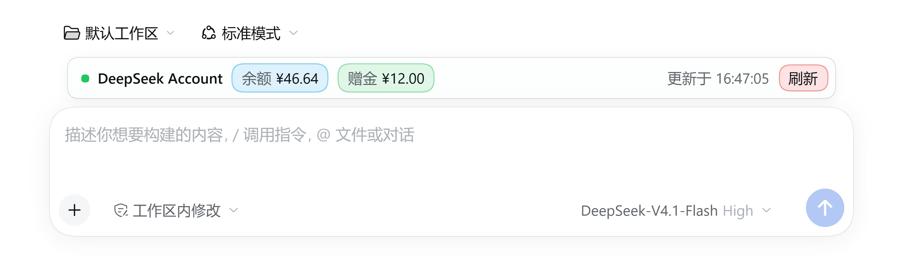
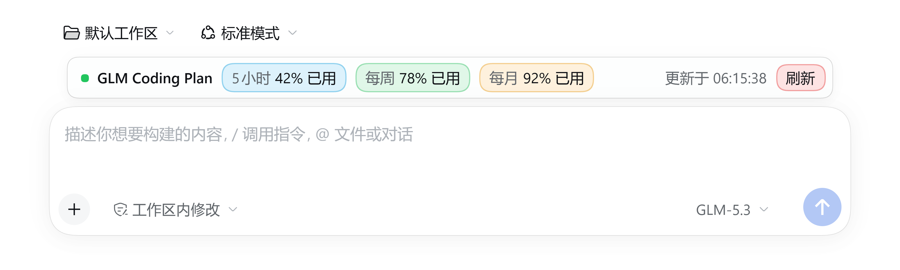
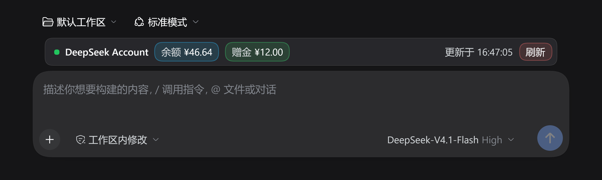
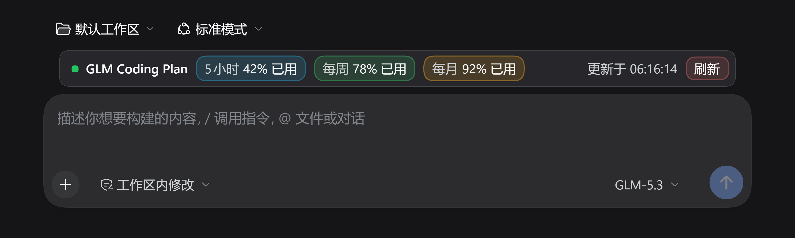

# 额度条 / Quota Line

输入框上方的一条通栏额度条，显示当前模型的余额或限额，数据从你的 DeepSeek Harness 本地凭证**只读**获取。









## 显示内容

- **DeepSeek Account** —— 通过已登录账号读取钱包余额与赠金（OAuth 令牌由 DSH 管理，插件不接触密钥）。
- **DeepSeek API** —— `GET {baseURL}/user/balance`，使用 `deepseek-official` 路由的 `DEEPSEEK_API_KEY` 引用。
- **Moonshot / Kimi** —— `GET {baseURL}/v1/users/me/balance`。
- **Kimi Code 套餐** —— `GET {baseURL}/v1/usages`（base 默认 `https://api.kimi.com/coding`）。显示滚动 5 小时窗口、每周与每月限额的已用百分比；同时兼容旧版（`limits[]` + `usage`）与套餐比例（`usages.limit_5h` …）两种响应。
- **智谱 GLM** —— `GET {baseURL}/api/paas/v4/balance`（实验性；该供应商的响应结构没有官方文档）。
- **GLM Coding Plan** —— `GET {origin}/api/monitor/usage/quota/limit`。`unit=3` 的行折算为 5 小时窗口，`unit=6` 为每周窗口，`TIME_LIMIT` 为月度计数。编码套餐端点拒绝普通 API key 时，Host 会自动回退到余额端点。
- **自定义供应商** —— 在 *设置 → 额度条* 里添加声明式 HTTP 模板：方法、带 `{baseURL}` 的 URL、认证方式、凭证引用与 JSON 提取路径。

额度条跟随当前会话的模型选择器，供应商/模型一变就立即重新查询。页面可见时每隔 `refreshSeconds` 轮询一次。开启 **任务运行时自动刷新**（默认开启）后，Host 会在每次模型响应结束后通过同源事件流通知，额度条随之刷新——最多每 8 秒一次，事件密集时补一次收尾刷新；只消费当前 provider 的 tick，所以跑在其他 provider 上的子代理不会刷新本条。事件流不可用时回退轮询：连接正常但安静时 60 秒一次（例如长时间工具调用），事件流断开时 15 秒一次。

胶囊配色跟随明暗主题：余额与 5h 窗口用天蓝，赠金与每周窗口用成功色，每月窗口用警示色，Refresh 是与数值胶囊等高的淡红色胶囊。赠金为 0 时仍然显示；读不到的限额窗口直接省略，而不是显示占位符。

## 隐私与凭证

- 只通过 Host 的 `credentials` 服务读取凭证（`resolve` / `describe` / `listRecords` / `readRecord`），全程只读。插件从不调用 `set`、`unset`、`modifyRecord`、`deleteRecord`，不自行解析 `.credentials.yaml`，也不存储密钥。
- API key 不会进入浏览器：供应商请求在 Host 进程内发出，返回给前端的只有标签、金额、币种与百分比。
- 除你自己配置的供应商余额端点外，不会向任何第三方上传数据；插件没有遥测。
- 设置保存在 `<DSH_HOME>/dsh-quotaline/settings.json`（默认 `~/.dsh/dsh-quotaline/settings.json`），原子写入；没有硬编码任何操作系统路径。

## 设置

打开 **设置 → 额度条**：

- 刷新间隔：空闲轮询节奏，10–3600 秒。
- 任务运行时自动刷新（默认开启）：每次模型响应后通过同源事件流刷新，节流为每 8 秒一次，tick 按 provider 过滤，并有轮询兜底；关闭后只按空闲间隔刷新。
- 界面语言：跟随 DSH，或把本插件的额度条与设置页固定为中文 / English。
- 限额显示：限额胶囊显示已用（默认）或剩余；后缀跟随界面语言。余额胶囊不受影响。
- 内置模板列表（只读）。
- 自定义模板：供应商 id 匹配（支持 `*`）、显示名称、方法、URL、认证方式、凭证引用、余额路径、币种。**测试** 会通过 Host 发一次请求，并展示解析出的值与一小段响应样例。

DeepSeek API 模板的路径示例：余额 `balance_infos[*].total_balance`，币种 `balance_infos[*].currency`。

## 安装

```powershell
dsh plugin --profile desktop add dsh-quotaline
```

把 `desktop` 换成你实际使用的 profile，然后重启 DeepSeek Harness 以加载 Host 半边。

## 常见问题

- **未配置密钥 / No credential** —— 在 *设置 → 模型* 里保存供应商 key（或配置对应的环境变量引用）；额度条只读取本地已有的凭证。
- **暂无查询模板 / No template** —— 添加一个自定义模板；额度条的错误提示里会显示未能匹配的供应商 id。
- **查询失败 / Query failed** —— 在设置页点 **测试** 查看 HTTP 状态与响应样例，再调整 URL 或路径。
- **未登录 / Signed out** —— 在 *设置 → 账号* 里登录 DeepSeek 账号。

## 开发

没有构建步骤：`client.js` 通过 `window.__ModuleLoader__` 注册一个懒加载模块工厂，`index.js` 导出 Host 的 `apply`。

架构、路由契约与模板 schema 见 [ARCHITECTURE.md](./ARCHITECTURE.md)。英文详情页见 [DETAIL.md](./DETAIL.md)。
