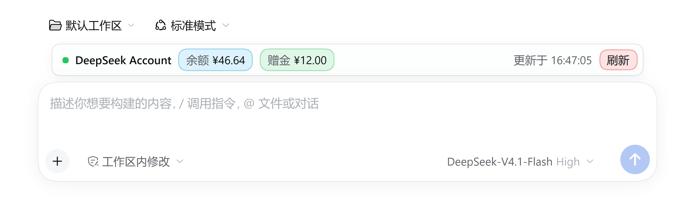
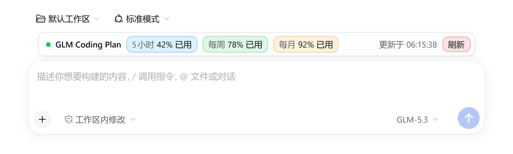
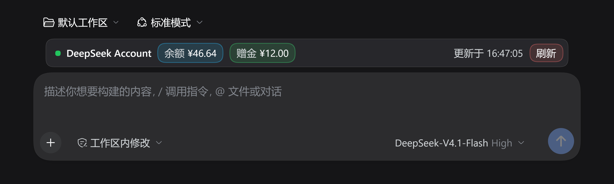
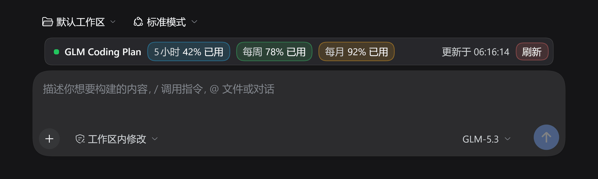

# dsh-quotaline

<div align="center">
  <b>输入框上方的额度条：显示你当前所用模型的余额或订阅限额。</b><br /><br />
  <a href="https://www.npmjs.com/package/dsh-quotaline"></a>
  <a href="https://opensource.org/licenses/MIT"></a>
  <a href="https://www.npmjs.com/package/@deepseek-ai/dsh"></a>
</div>

<div align="center">
  <a href="../README.md">English</a> · 简体中文
</div>

---

`dsh-quotaline` 在输入框上方的槽位里放一条单行额度条，跟随当前会话的模型：切到 DeepSeek Account 模型时显示账号钱包，切到 DeepSeek API 模型时显示对应 key 的余额；Kimi Code 与 GLM Coding Plan 则显示 5 小时 / 每周 / 每月的已用百分比。

- **不是悬浮球**：与输入框等宽、固定在输入框上方，始终可见。
- **跟随模型**：切换供应商/模型会立即重新查询，不会串号。
- **只读本地凭证**：不弹窗要 key、不同步、不上传，也不改写 `.credentials.yaml`。
- **内置模板 + 自定义**：DeepSeek、Moonshot/Kimi、Kimi Code、智谱、GLM Coding Plan 开箱可用；其他平台可在设置页用声明式 HTTP 模板描述。

## 效果预览

| 余额 · 浅色 | 限额 · 浅色 |
|---|---|
|  |  |

| 余额 · 深色 | 限额 · 深色 |
|---|---|
|  |  |

余额与 5h 窗口用天蓝，赠金与周窗口用绿色，月窗口用琥珀色，刷新按钮是淡红色气泡。赠金为 0 也保留；接口没返回的限额窗口直接不显示。浅色与深色主题均已适配。

## 功能

| 能力 | 说明 |
|---|---|
| **当前模型** | 读取会话的 `modelSelection` projection；空白会话回退到 profile 默认模型。 |
| **DeepSeek Account** | 走 DSH 的 OAuth 账号服务，显示余额与赠金。 |
| **DeepSeek API** | `GET {baseURL}/user/balance`，Bearer 认证，支持 CNY/USD。 |
| **Kimi Code** | `GET https://api.kimi.com/coding/v1/usages`，同时兼容旧版 `limits[]` 与新版 `usages.limit_5h / limit_7d / limit_month_*`。 |
| **GLM Coding Plan** | `GET {origin}/api/monitor/usage/quota/limit`，`unit=3` 折算为小时、`unit=6` 为周、`TIME_LIMIT` 为月度。 |
| **Moonshot / 智谱 API** | 标准余额端点；编码套餐 key 被余额端点拒绝时自动回退。 |
| **自定义查询** | 方法、URL（支持 `{baseURL}`/`{origin}` 占位）、认证方式、凭证引用、JSON 提取路径（支持 `[*]` 展开）。 |
| **设置页** | `设置 → Quota Line`：刷新间隔、任务运行时自动刷新、界面语言、内置模板只读列表、自定义模板编辑与 **测试** 按钮。 |
| **任务运行时自动刷新** | 默认开启：Agent 每次模型响应后刷新，通过同源事件流推送；事件流不可用时自动回退轮询。tick 按 provider 过滤，子代理使用其他 provider 时不会刷新本条带。 |
| **隐私** | Key 只留在 Host 进程；浏览器只收到标签、金额、币种、百分比与错误文案。无遥测。 |

### 内置供应商

| 供应商 | 显示内容 | 端点 |
|---|---|---|
| DeepSeek Account（`deepseek-account`） | 余额 + 赠金 | DSH 账号服务（OAuth） |
| DeepSeek API（`deepseek-official`） | 余额 | `GET {baseURL}/user/balance` |
| Moonshot / Kimi API | 余额 | `GET {baseURL}/v1/users/me/balance` |
| Kimi Code | 5h / 周 / 月用量 | `GET {baseURL}/v1/usages` |
| 智谱 API | 余额 | `GET {baseURL}/api/paas/v4/balance` |
| GLM Coding Plan | 5h / 周 / 月用量 | `GET {origin}/api/monitor/usage/quota/limit` |

## 数值与舍入

条带只负责把供应商返回的原始值格式化，不改写存储的数值；但舍入规则是固定且
写明的，保证两次会话对同一个数字给出同样的结果。

- **余额**固定两位小数、四舍五入：`5.198` 显示为 `¥5.20`，`5.192` 显示为
  `¥5.19`，`0.005` 显示为 `¥0.01`。舍入在十进制字符串上完成，而不是在二进制
  浮点上，所以以 5 结尾的值不会被抹小（`1.005` 仍然是 `¥1.01`）。
- **限额**取整数百分比、四舍五入：`42.42%` 显示为 `42%`，`42.5%` 显示为
  `43%`。「剩余」模式按已舍入的值渲染 `100 − 已用`，因此「已用」与「剩余」
  相加永远正好是 100%。
- **100% 与 0% 只代表真实边界**：已用 `99.6%` 显示为 `99%`，剩余 `0.4%`
  显示为 `99%`，条带不会在还有余量时宣告额度耗尽。
- 百分比会被限制在 `0–100`；供应商返回超过 100% 时显示为 `100%`。

## 安装

```sh
dsh plugin --profile desktop add dsh-quotaline
```

把 `desktop` 换成你实际使用的 profile（`web`、`desktop` 或自定义名称）。首次安装后重启一次 DeepSeek Harness，确保 Host 半与客户端 bundle 都加载；仅改动客户端代码时刷新页面即可。

需要 DeepSeek Harness **0.2.2-rc.3 或更新版本**。

## 设置

打开 **设置 → Quota Line**：

1. **刷新间隔** — 空闲时的刷新间隔，10 到 3600 秒；切换模型时始终立即刷新。
2. **任务运行时自动刷新** — 默认开启：Agent 每次模型响应后刷新，事件刷新最少间隔 8 秒（尾随补一次）。事件流不可用时回退轮询：在线但长时间无事件 60 秒、事件流断开 15 秒。关闭后只按空闲间隔（以及手动、切换模型、页面重新可见时）刷新。
3. **界面语言** — 跟随 DSH，或单独固定为中文 / English。
4. **限额显示** — 限额气泡显示 `已用`（默认）或 `剩余`；后缀跟随界面语言（`used`/`left` 或 `已用`/`剩余`），余额气泡不受影响。
5. **内置模板** — 只读列表，显示 id、名称与 experimental 标记。
6. **自定义模板** — 供应商 id 匹配（支持通配符）、显示名、方法、URL、认证方式、凭证引用、金额路径、币种路径与启用开关。点 **测试** 会由 Host 发起一次真实请求，并展示提取结果与响应样例。

路径示例：

- DeepSeek API：`balance_infos[*].total_balance`，币种 `balance_infos[*].currency`
- Moonshot：`data.available_balance`
- 智谱：`data.balance`（实验性）

自定义模板保存在 `$DSH_HOME/dsh-quotaline/settings.json`（Windows 默认 `~/.dsh/dsh-quotaline/settings.json`，其他平台为 `~/.dsh/...`）。路径在运行期解析，不写死盘符。

## 隐私

- 仅通过 Host `credentials` 服务读取凭证，不调用任何写入方法，也不自行解析或改写 `~/.dsh/.credentials.yaml`。
- 厂商请求由本机 Host 发出；客户端只访问同源 `/dsh-quotaline/api/*`，响应不含 key。
- 无遥测、无中转服务，也不会额外登录任何账号。

## 排障

| 现象 | 处理 |
|---|---|
| `未配置密钥` | 到 **设置 → 模型** 保存该供应商的 key，或配置对应环境变量引用。 |
| `暂无查询模板` | 在设置页为该供应商 id 添加自定义模板；条带会提示未匹配到的 id。 |
| `查询失败` | 在设置页点 **测试** 查看 HTTP 状态与响应样例，再调整 URL 或提取路径。 |
| `未登录` | 到 **设置 → 账号** 登录 DeepSeek 账号。 |
| 条带不出现 | 确认插件已在该 profile 启用，然后重新加载窗口。 |

## 文档

- [插件详情](./DETAIL.md) — DSH 插件详情页展示的概览。
- [架构设计](./ARCHITECTURE.md) — Host/Client 边界、路由契约、匹配规则与模板 schema。
- [更新日志](./CHANGELOG.md) — 版本变更记录。

## License

MIT © 2026 QianChang927
